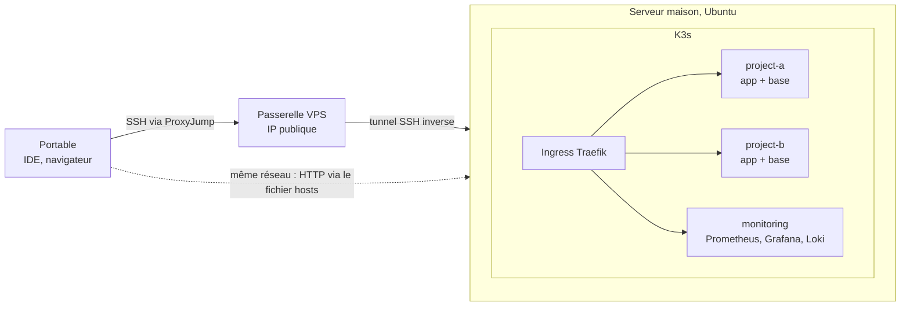

# k3s-devops-lab

[English](README.md) | **Français** | [Українська](README.uk.md) | [Русский](README.ru.md)

Instructions pas à pas pour transformer un mini-PC (ou un VPS cloud) en serveur de développement : Ubuntu Server, SSH durci, Docker, K3s avec Traefik, vos projets déployés sous forme de manifestes Kubernetes, accès distant depuis n'importe où, CI/CD et supervision. WordPress sert d'exemple, mais la même approche fonctionne pour n'importe quelle stack web.

Le résultat : une boîte dans un coin qui fait tourner vos sites 24 h/24, et un ordinateur portable qui ne contient plus qu'un éditeur et un navigateur.

## Vue d'ensemble

## Pourquoi avoir son propre serveur de développement

- **Portable ancien ou peu puissant.** Conteneurs, bases de données et supervision tournent sur le serveur. Le portable ne fait tourner qu'un IDE et un navigateur.
- **Un serveur de dev pour une petite équipe.** Même environnement pour tous, un seul endroit pour déployer et consulter les logs.
- **Plusieurs projets en même temps.** Chaque projet vit dans son propre namespace : deux ou trois sites côte à côte, et des tests d'intégration entre eux.
- **Proche de la production.** Mêmes conteneurs, même ingress et mêmes manifestes qu'un vrai cluster Kubernetes, pas un tas de fichiers `docker-compose`.
- **Économique.** Un mini-PC d'occasion est amorti en quelques mois de location de machines cloud équivalentes, et on ne paie pas les périodes d'inactivité.
- **Accès de partout.** Un petit VPS avec IP publique relaie le SSH vers la machine située derrière votre box.
- **Terrain d'expérimentation.** Helm, Prometheus/Grafana/Loki : on peut tout casser sans rien risquer d'important.
- **Portable propre.** Plus de conflits entre versions locales de PHP, Node et MySQL.

## Contenu

| Partie | Ce que vous obtenez |
|---|---|
| OS et réseau | Installation d'Ubuntu Server, IP statique, hostname |
| Sécurité | Clés SSH, port non standard, UFW, Fail2ban |
| Conteneurs | Docker, K3s, ingress Traefik, prompt shell et alias kubectl |
| Git et IDE | Clés SSH pour Git, identités pro/perso séparées, PhpStorm / VS Code via SSH |
| Déploiement des projets | Organisation des manifestes, déploiement pas à pas, manifestes WordPress commentés, migration d'un site |
| Accès distant | Passerelle VPS, tunnel SSH inverse, ProxyJump |
| CI/CD | GitLab Runner et pipeline de déploiement dans K3s |
| Supervision | Helm, Prometheus + Grafana, Loki |
| Extras | Partage de fichiers Samba |

## Par où commencer

- [English documentation](en/README.md)
- [Documentation en français](fr/README.md)
- [Документація українською](uk/README.md)
- [Документация на русском](ru/README.md)

## Hors périmètre

Hébergement de production, clusters multi-nœuds, haute disponibilité. Il s'agit d'un environnement de développement mono-nœud.
