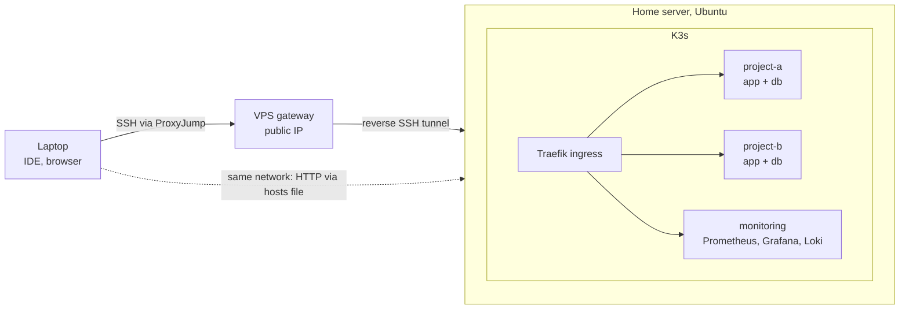

# k3s-devops-lab

**English** | [Français](README.fr.md) | [Українська](README.uk.md) | [Русский](README.ru.md)

Step-by-step instructions for turning a mini-PC (or a cloud VPS) into a dev server: Ubuntu Server, hardened SSH, Docker, K3s with Traefik, your projects running as Kubernetes manifests, remote access from anywhere, CI/CD and monitoring. WordPress is used as the example project, the same approach works for any web stack.

The result: a box in the corner that runs your sites 24/7, and a laptop that only holds an editor and a browser.

## How it fits together

## Why run your own dev server

- **Weak or old laptop.** Containers, databases and monitoring run on the server. The laptop only runs an IDE and a browser.
- **One dev server for a small team.** Everyone gets the same environment, one place to deploy and look at logs.
- **Several projects at once.** Each project lives in its own namespace, so you can run two or three sites side by side and test integration between them.
- **Close to production.** Same containers, ingress and manifests as in a real Kubernetes cluster, not a pile of `docker-compose` files.
- **Cheap.** A used mini-PC pays for itself against a month or two of equivalent cloud VMs, and there is no bill for idle time.
- **Access from anywhere.** A small VPS with a public IP forwards SSH to the box behind your home router.
- **Room to experiment.** Helm, Prometheus/Grafana/Loki: break things without touching anything that matters.
- **Clean laptop.** No local PHP/Node/MySQL versions fighting each other.

## What's inside

| Part | What you get |
|---|---|
| OS and network | Ubuntu Server install, static IP, hostname |
| Security | SSH keys, non-default port, UFW, Fail2ban |
| Containers | Docker, K3s, Traefik ingress, shell prompt and kubectl aliases |
| Git and IDE | SSH keys for Git, separate work/personal identities, PhpStorm / VS Code over SSH |
| Deploying projects | Manifest layout, deploy walkthrough, annotated WordPress manifests, site migration |
| Remote access | VPS gateway, reverse SSH tunnel, ProxyJump |
| CI/CD | GitLab Runner and a pipeline that deploys into K3s |
| Monitoring | Helm, Prometheus + Grafana, Loki |
| Extras | Samba file share |

## Status

The manual guide documents one real home-server setup and was written from the author's notes; it has not been replayed from scratch. See [known differences and problems not covered](en/docs/99-appendix/known-differences.md). An automated, tested version for AWS is in development.

## Start here

- [English documentation](en/README.md)
- [Documentation en français](fr/README.md)
- [Документація українською](uk/README.md)
- [Документация на русском](ru/README.md)

## Not a goal

Production hosting, multi-node clusters, high availability. This is a single-node dev environment.
