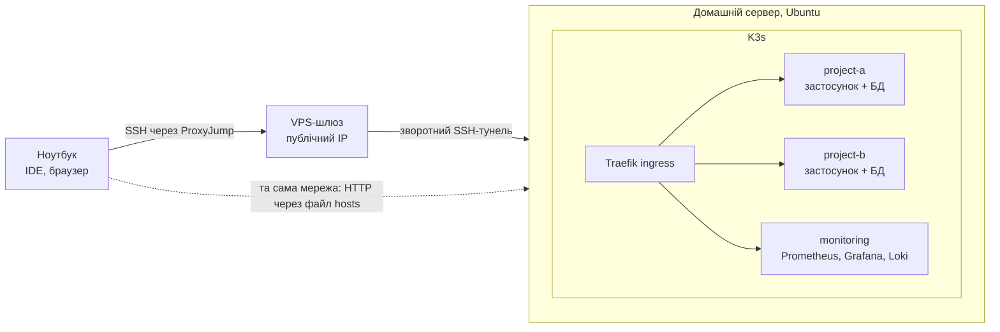

# k3s-devops-lab

[English](README.md) | [Français](README.fr.md) | **Українська** | [Русский](README.ru.md)

Покрокові інструкції: як перетворити міні-ПК (або хмарний VPS) на dev-сервер. Ubuntu Server, захищений SSH, Docker, K3s з Traefik, проєкти у вигляді Kubernetes-маніфестів, віддалений доступ звідки завгодно, CI/CD і моніторинг. Як приклад використано WordPress, але підхід підходить для будь-якого веб-стеку.

Результат: коробка в кутку, яка цілодобово крутить ваші сайти, і ноутбук, на якому залишаються тільки редактор і браузер.

## Як це влаштовано

## Навіщо власний dev-сервер

- **Слабкий або старий ноутбук.** Контейнери, бази даних і моніторинг працюють на сервері. На ноутбуці лише IDE і браузер.
- **Один dev-сервер на невелику команду.** У всіх однакове середовище, одне місце для деплою і перегляду логів.
- **Кілька проєктів одночасно.** Кожен проєкт живе у власному namespace, можна підняти два-три сайти поруч і перевіряти інтеграцію між ними.
- **Ближче до продакшену.** Ті самі контейнери, ingress і маніфести, що й у справжньому кластері Kubernetes, а не набір файлів `docker-compose`.
- **Дешево.** Вживаний міні-ПК окупається за кілька місяців оренди порівнянних хмарних машин, за простій платити не потрібно.
- **Доступ звідки завгодно.** Невеликий VPS із публічним IP прокидає SSH на машину за домашнім роутером.
- **Місце для експериментів.** Helm, Prometheus/Grafana/Loki: можна ламати, нічого важливого не чіпаючи.
- **Чистий ноутбук.** Жодних конфліктів локальних версій PHP/Node/MySQL.

## Що всередині

| Розділ | Що виходить |
|---|---|
| ОС і мережа | Встановлення Ubuntu Server, статична IP-адреса, hostname |
| Безпека | SSH-ключі, нестандартний порт, UFW, Fail2ban |
| Контейнери | Docker, K3s, Traefik ingress, промпт і аліаси kubectl |
| Git та IDE | SSH-ключі для Git, окремі робочий/особистий профілі, PhpStorm / VS Code по SSH |
| Деплой проєктів | Структура маніфестів, покроковий деплой, розбір маніфестів WordPress, перенесення сайту |
| Віддалений доступ | VPS-шлюз, зворотний SSH-тунель, ProxyJump |
| CI/CD | GitLab Runner і пайплайн із деплоєм у K3s |
| Моніторинг | Helm, Prometheus + Grafana, Loki |
| Додатково | Samba-шара |

## З чого почати

- [English documentation](en/README.md)
- [Documentation en français](fr/README.md)
- [Документація українською](uk/README.md)
- [Документация на русском](ru/README.md)

## Чого тут немає

Продакшен-хостингу, мультинодових кластерів і високої доступності. Це одновузлове dev-середовище.
