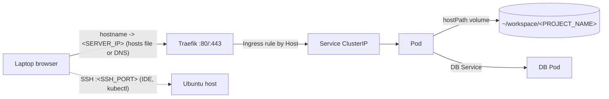

# Architecture overview

Layers, request flow and directory layout of the setup. Read it once before the install steps; nothing here needs to be executed.

## Layers

| Layer | Component | Role |
|---|---|---|
| 1 | Ubuntu Server LTS | OS, static IP, users, SSH |
| 2 | UFW, Fail2ban, key-only SSH | Perimeter security |
| 3 | Docker | Building and testing images |
| 4 | K3s (single node) | Runs containers as Pods, restarts them, provides service discovery |
| 5 | Traefik (bundled with K3s) | Ingress controller: routes HTTP by hostname |
| 6 | Namespaces | One per project (`<PROJECT_NAME>`), plus `monitoring` and similar |

## Request flow



1. The laptop resolves `<PROJECT_NAME>.<DOMAIN_BASE>` to `<SERVER_IP>` (local `/etc/hosts` entry or a real DNS record).
2. Traefik listens on ports 80/443 of the host and picks the Ingress rule matching the `Host` header.
3. The Ingress points to a Service, a stable internal address that load-balances over Pods.
4. The Pod serves the request; its code directory is a `hostPath` mount of the server folder, so edits made over SSH are visible immediately (a Pod restart is needed only for compiled code or cached config).

## Two directory trees

Code and run configuration are kept in separate trees with identical project names.

```
~/workspace/                         # code only (Git repositories)
└── <PROJECT_NAME>/

~/k8s-infrastructure/                # manifests only (its own Git repo)
├── system/
│   ├── ingress/                     # global Traefik settings
│   └── monitoring/                  # Prometheus, Grafana, Loki values
└── projects/
    └── <PROJECT_NAME>/
        ├── db.yaml               # Deployment + Service (+ PVC)
        ├── phpmyadmin.yaml       # Deployment + Service + Ingress
        └── app.yaml              # Deployment + Service + Ingress
```

- Same folder name in both trees, so helper functions can map a project name to its manifests.
- Numeric prefixes only document dependency order (DB, admin tool, app); Kubernetes does not enforce it. The app may crash once and restart until the DB is ready.
- One YAML file with several objects separated by `---` is equally valid for small projects.
- Apply a whole project with `kubectl apply -R -f ~/k8s-infrastructure/projects/<PROJECT_NAME>/`.

> **Warning:** Editing code does not restart anything. Code mounted via `hostPath` is live; code baked into an image needs a rebuild and re-apply.

## Where to change what

| Task | Location |
|---|---|
| Edit application code | `~/workspace/<PROJECT_NAME>/` |
| Change domain, replicas, env vars | `projects/<PROJECT_NAME>/app.yaml` |
| Change DB size or credentials | `projects/<PROJECT_NAME>/db.yaml` |
| Global ingress behaviour | `system/ingress/` |
| Monitoring stack | `system/monitoring/` |

Details: [Manifest structure and conventions](../05-deploying-projects/k8s-structure-conventions.md).

Next: [Prerequisites and variables](prerequisites-and-variables.md)
