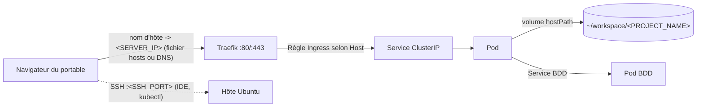

# Vue d'ensemble de l'architecture

Couches, flux des requêtes et organisation des répertoires de l'installation. À lire une fois avant les étapes d'installation ; rien de ce qui suit n'est à exécuter.

## Couches

| Couche | Composant | Rôle |
|---|---|---|
| 1 | Ubuntu Server LTS | Système d'exploitation, IP statique, utilisateurs, SSH |
| 2 | UFW, Fail2ban, SSH par clé uniquement | Sécurité du périmètre |
| 3 | Docker | Construction et test des images |
| 4 | K3s (nœud unique) | Exécute les conteneurs sous forme de Pods, les redémarre, fournit la découverte de services |
| 5 | Traefik (intégré à K3s) | Ingress controller : route le HTTP selon le nom d'hôte |
| 6 | Namespaces | Un par projet (`<PROJECT_NAME>`), plus `monitoring`, `ai` et similaires |

## Flux des requêtes



1. Le portable résout `<PROJECT_NAME>.<DOMAIN_BASE>` vers `<SERVER_IP>` (entrée locale dans `/etc/hosts` ou enregistrement DNS réel).
2. Traefik écoute sur les ports 80/443 de l'hôte et choisit la règle Ingress correspondant à l'en-tête `Host`.
3. L'Ingress pointe vers un Service, une adresse interne stable qui répartit la charge entre les Pods.
4. Le Pod traite la requête ; son répertoire de code est un montage `hostPath` du dossier du serveur, de sorte que les modifications faites via SSH sont visibles immédiatement (un redémarrage du Pod n'est nécessaire que pour le code compilé ou la configuration mise en cache).

## Deux arborescences de répertoires

Le code et la configuration d'exécution sont séparés dans deux arborescences portant des noms de projet identiques.

```
~/workspace/                         # code uniquement (dépôts Git)
└── <PROJECT_NAME>/

~/k8s-infrastructure/                # manifestes uniquement (son propre dépôt Git)
├── system/
│   ├── ingress/                     # paramètres globaux de Traefik
│   └── monitoring/                  # values de Prometheus, Grafana, Loki
├── ai-models/
│   └── ollama/
└── projects/
    └── <PROJECT_NAME>/
        ├── db.yaml               # Deployment + Service (+ PVC)
        ├── phpmyadmin.yaml       # Deployment + Service + Ingress
        └── app.yaml              # Deployment + Service + Ingress
```

- Même nom de dossier dans les deux arborescences, afin que des fonctions utilitaires puissent associer un nom de projet à ses manifestes.
- Les préfixes numériques ne font que documenter l'ordre des dépendances (BDD, outil d'administration, application) ; Kubernetes ne l'impose pas. L'application peut planter une fois et redémarrer jusqu'à ce que la BDD soit prête.
- Un seul fichier YAML contenant plusieurs objets séparés par `---` est tout aussi valide pour les petits projets.
- Appliquez un projet entier avec `kubectl apply -R -f ~/k8s-infrastructure/projects/<PROJECT_NAME>/`.

> **Avertissement :** modifier le code ne redémarre rien. Le code monté via `hostPath` est pris en compte en direct ; le code intégré à une image nécessite une reconstruction et un nouvel `apply`.

## Où modifier quoi

| Tâche | Emplacement |
|---|---|
| Modifier le code de l'application | `~/workspace/<PROJECT_NAME>/` |
| Changer le domaine, les réplicas, les variables d'environnement | `projects/<PROJECT_NAME>/app.yaml` |
| Changer la taille ou les identifiants de la BDD | `projects/<PROJECT_NAME>/db.yaml` |
| Comportement global de l'ingress | `system/ingress/` |
| Pile de supervision | `system/monitoring/` |

Détails : [Structure des manifestes et conventions](../05-deploying-projects/k8s-structure-conventions.md).

Suite : [Prérequis et variables](prerequisites-and-variables.md)
