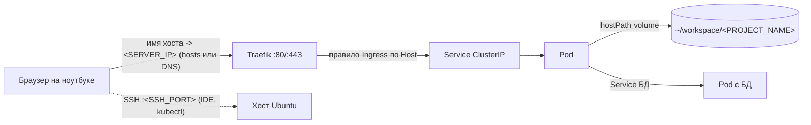

# Обзор архитектуры

Слои, путь запроса и структура каталогов. Прочитайте один раз перед установкой; выполнять здесь ничего не нужно.

## Слои

| Слой | Компонент | Роль |
|---|---|---|
| 1 | Ubuntu Server LTS | ОС, статический IP, пользователи, SSH |
| 2 | UFW, Fail2ban, SSH только по ключам | Защита периметра |
| 3 | Docker | Сборка и проверка образов |
| 4 | K3s (один узел) | Запускает контейнеры как Pod, перезапускает их, обеспечивает service discovery |
| 5 | Traefik (входит в K3s) | Ingress-контроллер: маршрутизирует HTTP по имени хоста |
| 6 | Namespace | По одному на проект (`<PROJECT_NAME>`), плюс `monitoring` и т. п. |

## Путь запроса



1. Ноутбук резолвит `<PROJECT_NAME>.<DOMAIN_BASE>` в `<SERVER_IP>` (запись в локальном `/etc/hosts` или настоящая DNS-запись).
2. Traefik слушает порты 80/443 хоста и выбирает правило Ingress, совпадающее с заголовком `Host`.
3. Ingress указывает на Service — стабильный внутренний адрес, балансирующий нагрузку между Pod.
4. Pod обрабатывает запрос; каталог с кодом смонтирован через `hostPath` из папки сервера, поэтому правки по SSH видны сразу (перезапуск Pod нужен только для компилируемого кода или закэшированной конфигурации).

## Два дерева каталогов

Код и конфигурация запуска хранятся раздельно, имена проектов совпадают.

```
~/workspace/                         # только код (Git-репозитории)
└── <PROJECT_NAME>/

~/k8s-infrastructure/                # только манифесты (отдельный Git-репозиторий)
├── system/
│   ├── ingress/                     # глобальные настройки Traefik
│   └── monitoring/                  # values для Prometheus, Grafana, Loki
└── projects/
    └── <PROJECT_NAME>/
        ├── db.yaml               # Deployment + Service (+ PVC)
        ├── phpmyadmin.yaml       # Deployment + Service + Ingress
        └── app.yaml              # Deployment + Service + Ingress
```

- Одинаковое имя папки в обоих деревьях позволяет вспомогательным функциям находить манифесты по имени проекта.
- Числовые префиксы лишь отражают порядок зависимостей (БД, админка, приложение); Kubernetes его не гарантирует. Приложение может один раз упасть и перезапуститься, пока БД не поднимется.
- Для небольших проектов подойдёт один YAML-файл с несколькими объектами, разделёнными `---`.
- Применить проект целиком: `kubectl apply -R -f ~/k8s-infrastructure/projects/<PROJECT_NAME>/`.

> **Warning:** Правка кода ничего не перезапускает. Код, смонтированный через `hostPath`, обновляется сразу; код, вшитый в образ, требует пересборки и повторного применения.

## Где что менять

| Задача | Место |
|---|---|
| Править код приложения | `~/workspace/<PROJECT_NAME>/` |
| Домен, число реплик, переменные окружения | `projects/<PROJECT_NAME>/app.yaml` |
| Размер БД или учётные данные | `projects/<PROJECT_NAME>/db.yaml` |
| Глобальное поведение ingress | `system/ingress/` |
| Стек мониторинга | `system/monitoring/` |

Подробности: [Структура манифестов и соглашения](../05-deploying-projects/k8s-structure-conventions.md).

Далее: [Требования и переменные](prerequisites-and-variables.md)
