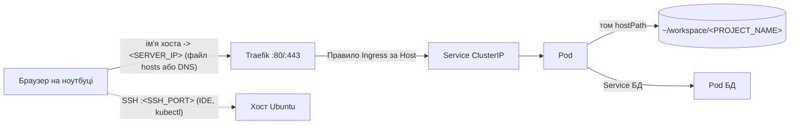

# Огляд архітектури

Шари, шлях запиту та структура каталогів цього налаштування. Прочитайте один раз перед кроками встановлення; нічого з описаного тут виконувати не потрібно.

## Шари

| Шар | Компонент | Роль |
|---|---|---|
| 1 | Ubuntu Server LTS | ОС, статична IP-адреса, користувачі, SSH |
| 2 | UFW, Fail2ban, SSH лише за ключем | Захист периметра |
| 3 | Docker | Збирання та тестування образів |
| 4 | K3s (один вузол) | Запускає контейнери як Pod, перезапускає їх, забезпечує service discovery |
| 5 | Traefik (входить до K3s) | Ingress-контролер: маршрутизує HTTP за іменем хоста |
| 6 | Namespace | По одному на проєкт (`<PROJECT_NAME>`), а також `monitoring`, `ai` тощо |

## Шлях запиту



1. Ноутбук резолвить `<PROJECT_NAME>.<DOMAIN_BASE>` у `<SERVER_IP>` (локальний запис у `/etc/hosts` або справжній DNS-запис).
2. Traefik слухає порти 80/443 хоста і вибирає правило Ingress, що відповідає заголовку `Host`.
3. Ingress вказує на Service, стабільну внутрішню адресу, що балансує навантаження між Pod.
4. Pod обробляє запит; його каталог із кодом змонтовано через `hostPath` з папки сервера, тому зміни, зроблені через SSH, видно одразу (перезапуск Pod потрібен лише для скомпільованого коду або кешованої конфігурації).

## Два дерева каталогів

Код і конфігурація запуску зберігаються в окремих деревах з однаковими назвами проєктів.

```
~/workspace/                         # лише код (Git-репозиторії)
└── <PROJECT_NAME>/

~/k8s-infrastructure/                # лише маніфести (власний Git-репозиторій)
├── system/
│   ├── ingress/                     # глобальні налаштування Traefik
│   └── monitoring/                  # values для Prometheus, Grafana, Loki
├── ai-models/
│   └── ollama/
└── projects/
    └── <PROJECT_NAME>/
        ├── db.yaml               # Deployment + Service (+ PVC)
        ├── phpmyadmin.yaml       # Deployment + Service + Ingress
        └── app.yaml              # Deployment + Service + Ingress
```

- Однакова назва папки в обох деревах, щоб допоміжні функції могли зіставляти назву проєкту з його маніфестами.
- Числові префікси лише документують порядок залежностей (БД, адмін-інструмент, застосунок); Kubernetes його не вимагає. Застосунок може один раз впасти і перезапускатися, поки БД не буде готова.
- Для невеликих проєктів так само допустимий один YAML-файл із кількома об'єктами, розділеними `---`.
- Застосувати весь проєкт: `kubectl apply -R -f ~/k8s-infrastructure/projects/<PROJECT_NAME>/`.

> **Попередження:** Редагування коду нічого не перезапускає. Код, змонтований через `hostPath`, оновлюється наживо; код, вбудований в образ, потребує перезбирання та повторного застосування.

## Що де змінювати

| Завдання | Розташування |
|---|---|
| Редагувати код застосунку | `~/workspace/<PROJECT_NAME>/` |
| Змінити домен, кількість реплік, змінні середовища | `projects/<PROJECT_NAME>/app.yaml` |
| Змінити розмір БД або облікові дані | `projects/<PROJECT_NAME>/db.yaml` |
| Глобальна поведінка ingress | `system/ingress/` |
| Стек моніторингу | `system/monitoring/` |

Докладніше: [Структура маніфестів і конвенції](../05-deploying-projects/k8s-structure-conventions.md).

Далі: [Вимоги та змінні](prerequisites-and-variables.md)
